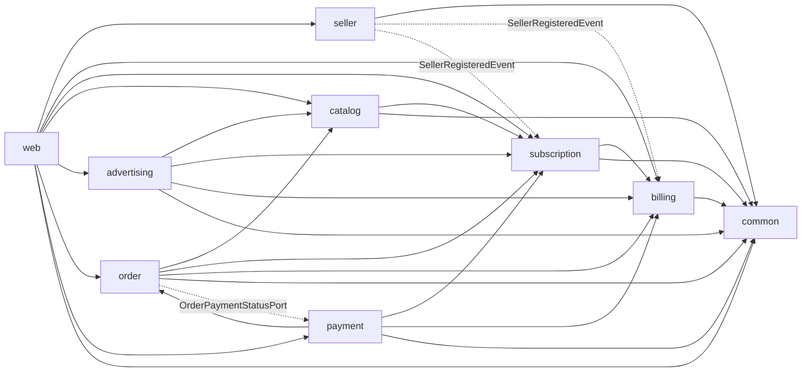
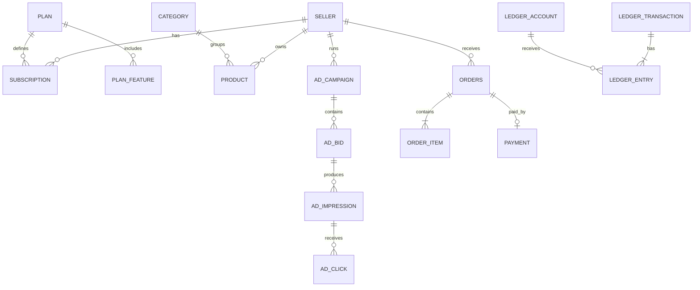

# Архітектура

## 1. Огляд

Модульний моноліт: один Spring Boot застосунок, код організований за функціями (package-by-feature). Модулі спілкуються через публічні сервіси та синхронні події Spring (`ApplicationEvent`). Рішення описане в [ADR 0001](adr/0001-modular-monolith.md).

Технології: Java 21, Spring Boot 3.5, Spring Data JPA, Flyway, H2 (режим PostgreSQL) для розробки і тестів, PostgreSQL 16 у профілі `postgres`, ArchUnit для охорони меж.

## 2. Граф модулів

Суцільна стрілка: залежність у коді (A залежить від B). Пунктир: подія або порт. Модулі `billing` і `subscription` залежать від `seller` лише через клас події `SellerRegisteredEvent`. Граф не має циклів, це перевіряє `ArchitectureTest`.

## 3. Веб-інтерфейс (SSR)

Пакет `ua.marketplace.web` містить MVC-контролери (`@Controller`), форми і шаблони Thymeleaf (`src/main/resources/templates`). Він залежить від усіх модулів, але жоден модуль не залежить від нього. Контролери викликають лише публічні сервіси і працюють з DTO; репозиторії, сутності та REST-контролери з `web` недоступні (правила `ArchitectureTest`). Пакет поділено на `support` (форматування, повідомлення, обробка помилок), `shop` (вітрина), `seller` (кабінет) і `admin` (категорії). Докладніше: [ui.md](ui.md).

## 4. Відповідальність модулів

| Модуль | Відповідальність |
|---|---|
| common | `Money`, `Percent`, конвертери JPA, `ErrorCode`, глобальний обробник помилок, `Clock`, пагінація |
| seller | реєстрація продавця, публікація `SellerRegisteredEvent` |
| billing | подвійний запис, рахунки, баланс, поповнення, історія проводок |
| subscription | пакети, підписки, `PlanLimits` (ліміт товарів, видимість, функції) |
| catalog | категорії (комісія, мінімальна ставка), товари, вітрина |
| advertising | кампанії, ставки, рейтинг оголошень, покази, кліки та списання |
| order | замовлення, машина станів, комісія та її повернення |
| payment | платіж, комісія за платіж, заглушка шлюзу, вебхук, повернення |
| web | сторінки інтерфейсу: вітрина, кабінет продавця, адмінка категорій; форми, шаблони, обробка помилок для сторінок |

## 5. Події та порти

- `SellerRegisteredEvent(sellerId)`: `billing` відкриває рахунки `SELLER_BALANCE:{id}` і `SELLER_PAYABLE:{id}`, `subscription` створює підписку FREE. Слухачі синхронні, у тій самій транзакції: збій слухача відкочує реєстрацію.
- `OrderCancelledEvent`: публікується при скасуванні та поверненні замовлення. У Tier A слухачів немає, у Tier B на нього підпишеться модуль `payment` (автоповернення оплати).
- Порт `OrderPaymentStatusPort` (інтерфейс у `order`, реалізація `PaymentStatusAdapter` у `payment`): дозволяє `order` перевірити, чи оплачено замовлення, не залежачи від `payment`. Це інверсія залежності.

## 6. Модель даних (спрощено)

Між модулями немає зовнішніх ключів у БД (лише ідентифікатори). Таблиця замовлень називається `orders`, бо `order` є зарезервованим словом SQL.

## 7. Облік (коротко)

Подвійний запис: кожна проводка має рядки DEBIT і CREDIT, сума дебету дорівнює сумі кредиту. Баланс рахунку зберігається в самому рахунку з оптимістичною версією; при проводці рахунки блокуються за зростанням `id`. Унікальний ключ ідемпотентності запобігає подвійному проведенню. Повна таблиця рахунків і проводок: [monetization.md](monetization.md). Рішення: [ADR 0002](adr/0002-double-entry-ledger.md).

## 8. Помилки

Помилки REST API (`@RestController`) у форматі RFC 7807 (`application/problem+json`) з додатковим полем `code`; їх обробляє `GlobalExceptionHandler` (лише для `@RestController`). Сторінки інтерфейсу обробляє `WebExceptionHandler` (HTML, тексти з `messages.properties`), решту помилок обробляє Spring Boot. Неіснуючі шляхи під `/api`, 405 і 415 тепер повертають стандартну відповідь Boot.
Коди 400: `VALIDATION_ERROR`, `MALFORMED_REQUEST`. Коди 404: `*_NOT_FOUND`. Коди 409: бізнес-правила (`INSUFFICIENT_FUNDS`, `PRODUCT_LIMIT_EXCEEDED`, `INVALID_ORDER_TRANSITION` та інші). 500: `INTERNAL_ERROR` без деталей.

## 9. Профілі та запуск

- За замовчуванням (`dev`): H2 в пам'яті, `MODE=PostgreSQL`.
- Профіль `postgres`: PostgreSQL 16 за змінними `DB_HOST`, `DB_PORT`, `DB_NAME`, `DB_USER`, `DB_PASSWORD`.
- `ddl-auto=validate`, схемою керує лише Flyway. `open-in-view=false`.
- Час: єдиний `Clock` із зоною `Europe/Kyiv`.
- Автентифікації і захисту CSRF немає. Адмін-ендпоїнти під `/api/v1/admin/**` і сторінки `/admin/**` не захищені.

## 10. Ризики

| Ризик | Вплив | Дія |
|---|---|---|
| Boot 3.5 завершує підтримку | відсутність виправлень безпеки | issue про міграцію на Boot 4 |
| Торгова марка Prom.ua | юридичні претензії | лише фраза «на зразок», без логотипів |
| Ілюстративні числа | хибне сприйняття як офіційних | явна примітка в документах |
| Розбіжності H2 і PostgreSQL | помилки лише в проді | Testcontainers у Sprint 1 |
| Конкуренція за баланс | втрата оновлень | блокування рахунків, `@Version`, тест на 10 потоків |
| Округлення | розбіжності на копійки | правило по рядках, ADR 0003 |
| Від'ємний баланс через комісію | борг продавця | свідомо; обмеження і стягнення в беклозі |
| Немає автентифікації | неавторизований доступ | не розгортати публічно; issue про ролі |
| Немає CSRF | підміна запиту від імені продавця | `th:action` у всіх формах, захист разом з автентифікацією |
| Послідовні номери замовлень у публічних адресах | витік персональних даних | маска телефону, захищене посилання в беклозі |
| Завеликий Sprint 0 | зрив планування | Sprint 0 не враховується у швидкості |
| Новорічний Sprint 2 | знижена потужність | планування на 60% |
| Юридичне: ПРРО, ПДВ, провайдер | неможливість запуску в проді | спайк вибору провайдера |
