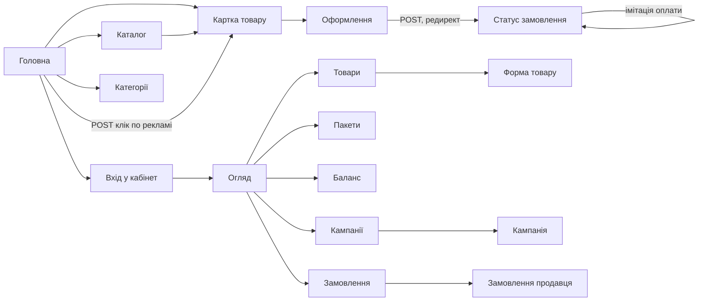

# Веб-інтерфейс

## 1. Призначення і принципи

Інтерфейс «Ринок» (підзаголовок «навчальний маркетплейс») показує роботу модуля монетизації в браузері: вітрина для покупця, кабінет продавця і мінімальна адмінка категорій. Це серверний рендеринг: Spring MVC і Thymeleaf, власний CSS, без JavaScript і без зовнішніх бібліотек.

Принципи:

- Шар `web` лише викликає публічні сервіси модулів. Прямого доступу до репозиторіїв і сутностей немає, це охороняє `ArchitectureTest`.
- Шаблони бачать тільки DTO і `record`, а не сутності JPA.
- Після кожної успішної дії форми виконується редирект на сторінку результату (Post/Redirect/Get). Повідомлення про успіх чи помилку передаються як flash-атрибути.
- Усі форми мають `th:action`, тож Thymeleaf додає токен CSRF, щойно з’явиться захист (дивись розділ 6).
- Усі тексти українською, у `messages.properties` зібрані назви статусів, пакетів, типів проводок і повідомлення для кожного `ErrorCode`.
- Сторінка має сенс без стилів: заголовки, підписи полів, таблиці з `caption` і `scope`, посилання «Перейти до змісту», `aria-current`, `role="alert"` для помилок.

## 2. Карта екранів

### Вітрина

| Адреса | Призначення |
|---|---|
| `GET /` | головна: категорії, блок «Рекомендовані» (реклама, якщо є), «Нові товари» |
| `GET /catalog?category=&q=&page=` | каталог з фільтром за категорією, пошуком і пагінацією |
| `GET /products/{id}` | картка товару, кількість і кнопка «Купити» |
| `POST /ads/{impressionId}/click` | клік по рекламі: списання ставки і перехід на товар |
| `GET /checkout?productId=&quantity=` | форма оформлення замовлення |
| `POST /checkout` | створення замовлення, редирект на `/orders/{id}` |
| `GET /orders/{id}` | сторінка статусу замовлення (телефон приховано маскою) |
| `POST /orders/{id}/pay` | повторна спроба онлайн-оплати після невдачі |
| `POST /dev/payments/{id}/success` і `/failure` | імітація відповіді платіжної системи (лише режим розробки) |

### Кабінет продавця

| Адреса | Призначення |
|---|---|
| `GET /cabinet` | вхід за номером продавця і реєстрація |
| `GET /cabinet/{sellerId}` | огляд: пакет, баланс, використання ліміту товарів, нові замовлення |
| `GET /cabinet/{sellerId}/products` | список товарів |
| `GET, POST /cabinet/{sellerId}/products/new` | створення товару |
| `GET, POST /cabinet/{sellerId}/products/{id}/edit` | редагування товару |
| `GET /cabinet/{sellerId}/plan` | пакети та їхня купівля (лише з пакета FREE) |
| `GET /cabinet/{sellerId}/balance` | баланс, поповнення, історія проводок з фільтром за типом |
| `GET, POST /cabinet/{sellerId}/campaigns` | список кампаній і створення |
| `GET /cabinet/{sellerId}/campaigns/{id}` | кампанія: бюджет, статус, ставки |
| `GET /cabinet/{sellerId}/orders` | замовлення з фільтром за статусом |
| `GET /cabinet/{sellerId}/orders/{id}` | замовлення і дозволені дії (підтвердити, відправити, завершити, скасувати, повернути) |

### Адмінка

| Адреса | Призначення |
|---|---|
| `GET, POST /admin/categories` | список і створення категорій |
| `POST /admin/categories/{id}/pricing` | зміна комісії та мінімальної ставки категорії |

## 3. Навігація

## 4. Форматування і стиль

- Гроші: `UiFormat.money`: «1 234,56 грн», де розділювач груп і пробіл перед «грн» це нерозривний пробіл U+00A0; нуль це «0,00 грн», мінус стоїть перед числом. Відсотки: «5,00 %». Дата й час: «04.12.2026 12:15» за київським часом, дата: «04.12.2026».
- Введення чисел: `UaDecimalEditor` приймає «1 234,56», «1234,5» і «1234.56». Запис із крапкою і комою одночасно («1.234,56») відхиляється, бо неоднозначний.
- Телефон покупця на публічній сторінці замовлення маскується: «+38050***33».
- Стиль: один файл `static/css/app.css`, змінні в `:root` (кольори, відступи, радіус), темна тема через `prefers-color-scheme`, контейнер до 1200 px, адаптивна сітка карток, меню переноситься на вузьких екранах. Іконка `static/favicon.svg` (монограма «Р»).
- Кольорова схема має контраст не нижчий за AA; фокус клавіатури видно завжди (`:focus-visible`).

## 5. Помилки

Є два шляхи помилок, і вони не змішуються.

- REST API (`@RestController`, адреси `/api/v1/**`): `GlobalExceptionHandler` повертає `application/problem+json` з полем `code`, як і раніше. Тепер він оголошений як `@RestControllerAdvice(annotations = RestController.class)`.
- Сторінки (`ua.marketplace.web`): `WebExceptionHandler` показує HTML-сторінку з повідомленням для відповідного `ErrorCode` з `messages.properties`. Деталі виняткових ситуацій користувачу не показуються; 500 завжди показує загальний текст.
- Невідомі адреси і помилки, які Spring MVC обробляє до контролера, потрапляють до обробника помилок Spring Boot, який віддає шаблони `error/404`, `error/4xx`, `error/5xx` для браузера і JSON для клієнтів без `Accept: text/html`.

Зміна поведінки API: неіснуючі шляхи під `/api`, помилки 405 (метод не дозволений) і 415 (непідтримуваний тип) раніше повертали `problem+json` з нашими кодами, а тепер повертають стандартну відповідь Spring Boot. Відомі помилки сервісів (`NotFoundException`, `BusinessRuleException`, валідація) і далі повертають `problem+json`.

## 6. Тимчасовий доступ і CSRF

- Автентифікації немає: кабінет відкривається за номером продавця в адресі, адмінка відкрита всім. На сторінках кабінету і адмінки показується попередження. Не розгортайте застосунок у відкритій мережі. Автентифікація запланована окремою історією беклогу.
- CSRF-захисту немає, бо немає Spring Security. Усі форми написані з `th:action`, тому токен з’явиться автоматично після підключення захисту. `TemplateHygieneTest` перевіряє, що жодної форми без `th:action` немає.
- Сторінка замовлення відкривається за послідовним номером. Щоб не розкривати персональні дані, телефон замаскований, а e-mail не показується. Захищене посилання для покупця винесено в беклог.

## 7. Режим розробки

Параметр `app.ui.dev-tools` (у `application.yml`: `true`, у профілі `postgres`: `false`) вмикає:

- кнопки «Оплата успішна» і «Оплата невдала» на сторінці замовлення з онлайн-оплатою;
- контролер `/dev/payments/{id}/{success|failure}`, який викликає той самий вебхук, що й API;
- посилання на адмінку в меню.

Коли параметр вимкнений, контролера немає (запит повертає помилку 4xx), а кнопки і посилання не відображаються.

## 8. Що залежить від беклогу

| Тема | Історія беклогу | Що змінить |
|---|---|---|
| Зміна пакета з перерахунком | «Зміна тарифу: підвищення з перерахунком і зниження з кінця періоду» | кнопки зміни пакета на сторінці пакетів (зараз купівля лише з FREE, бо повторна купівля на платному пакеті губить дні) |
| Автентифікація | «Автентифікація і ролі» | вхід замість номера в адресі, захист адмінки, CSRF |
| Захист від повторних кліків | «Захист від повторних і прострочених кліків» | зараз кожне відображення реклами створює покази, тому реклама показується лише на головній і в каталозі з категорією |
| Статистика кампанії | «Статистика рекламної кампанії» | показники на сторінці кампанії |
| Повернення замовлення | «Повернення замовлення протягом 14 днів і автоматичне повернення оплати» | строк 14 днів у кабінеті |
| Звіт доходів | «Звіт доходів платформи за джерелами» | сторінка звіту в адмінці |
| Міграція на Spring Boot 4 | «Міграція на Spring Boot 4» | оновлення Thymeleaf і Spring MVC |

## Ризики

| Ризик | Дія |
|---|---|
| Немає автентифікації | попередження на сторінках, не розгортати публічно |
| Немає CSRF | `th:action` у кожній формі, перевірка в `TemplateHygieneTest` |
| Номер замовлення послідовний | маска телефону, захищене посилання в беклозі |
| Показ реклами створює покази за кожен рендер | реклама лише на `/` і в каталозі з категорією |
| Подвійне надсилання оформлення | Post/Redirect/Get, подальше посилення в беклозі |
| Купівля пакета на платному пакеті губить дні | купівля лише з FREE до зміни пакета з перерахунком |
| Помилка шаблона виявляється лише під час виконання | кожен шаблон відтворюється принаймні одним тестом |
| Розбіжність форм і DTO | форми мають `toRequest`, тести проходять повний шлях |
| Лінива ініціалізація | шаблони бачать лише `record` |
| Два шляхи помилок | `ErrorHandlingTest`, `ServerErrorPagesTest`, `BootErrorPathTest` |
| Перевантажений Sprint 0 | історії інтерфейсу додані до Sprint 0 і не враховуються у швидкість |
| Заборонені символи й слова в текстах | `TemplateHygieneTest` і `MessagesCompletenessTest` |
